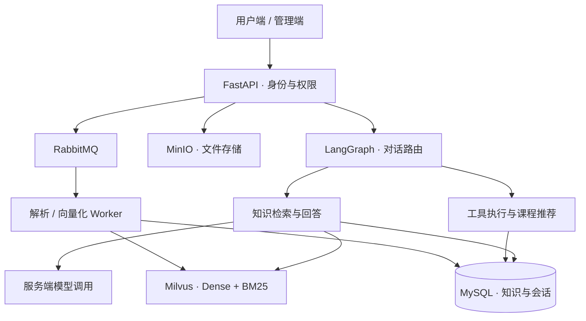

# AI 销售助手 · Agent & RAG 工程实践

面向教育销售场景的智能知识服务平台，将课程资料、政策知识和销售经验接入统一对话入口，支持知识问答、课程推荐、销售话术生成及知识库运营。

**[访问公网演示](http://47.83.145.248:8082/admin/) · [系统架构](docs/architecture.md) · [核心代码导览](code-excerpts/README.md) · [接口设计](docs/api-design.md)**

本仓库是实际项目的公开展示版本，包含从后端工程提取的核心代码、架构设计和合成接口样例。完整应用、业务数据、提示词资产及部署凭证保留在私有环境；公开目录可下载阅读，但不能直接启动完整服务。

## 在线体验

| 项目 | 说明 |
| --- | --- |
| 体验地址 | http://47.83.145.248:8082/admin/ |
| 体验账号 | 按需向项目作者索取，管理凭证不公开存储 |
| 建议流程 | 登录 → 提问 → 检查知识引用 → 查看推荐或工具执行结果 |
| 数据约定 | 请使用合成问题，不输入真实客户资料 |
| 可用性 | 以公网实际运行情况为准，不承诺持续在线 |

建议体验问题：

- “孩子初一，英语基础薄弱，想提升阅读能力，推荐课程前还需要了解哪些信息？”
- “家长认为课程价格较高，如何回复并继续了解真实需求？”
- “请根据现有知识库解释课程适用人群，并给出资料来源。”

回答取决于已发布知识和当前配置；缺少依据时应区分通用建议与知识库事实。[演示说明](docs/demo-guide.md)包含体验路径和截图状态。

## 核心能力

| 能力 | 具体实现 | 阅读入口 |
| --- | --- | --- |
| Agent 工作流 | LangGraph 状态图串联会话、路由、检索、课程推荐、工具调用和结果持久化 | [工作流](docs/agent-workflow.md) |
| 受控工具执行 | Pydantic 输入输出校验、权限检查、重试、执行记录与审计截断 | [执行器代码](code-excerpts/agent/tool_executor.py) |
| 混合检索 RAG | Milvus 稠密向量 + BM25，经 RRF 融合后结合业务过滤与重排序 | [检索方案](docs/rag-pipeline.md) |
| 检索容错 | 向量异常或无匹配时尝试 MySQL 关键词检索，记录降级来源 | [检索代码](code-excerpts/retrieval/hybrid_search.py) |
| 异步入库 | RabbitMQ 独立消费、手动 ACK、延迟重试、死信与待处理任务重投 | [后端工程](docs/engineering.md) |
| 大文件上传 | 分片校验、流式合并、SHA-256 完整性验证 | [合并代码](code-excerpts/uploads/stream_assembly.py) |
| 扩展集成 | 私有工程包含 MCP 知识问答工具及销售 Skill 蒸馏工具链 | [展示边界](docs/project-scope.md) |

## 系统架构



## 技术栈

Python / FastAPI / Pydantic / SQLAlchemy / MySQL / LangChain / LangGraph / Milvus / RabbitMQ / MinIO / Vue / Docker Compose。完整工程包含 SSE 流式输出、MCP 接入、LangSmith 跟踪及 Ragas / LLM-as-Judge 评估入口；本仓库未附完整环境或线上评测报告。

## 建议阅读顺序

1. [架构与服务边界](docs/architecture.md)：理解业务、数据流及组件职责。
2. [Agent 编排](docs/agent-workflow.md)：查看意图路由和权限边界。
3. [RAG 检索](docs/rag-pipeline.md)：查看召回、筛选及降级策略。
4. [后端工程实践](docs/engineering.md)：查看消息重试、上传和一致性处理。
5. [核心代码与来源清单](code-excerpts/README.md)：核对实际实现及依赖边界。

## 本地验证

无需模型密钥、数据库或第三方 Python 包；在仓库根目录使用 Python 3.10+：

```bash
python -m unittest discover -s tests -v
python scripts/verify_showcase.py
```

测试覆盖公开文本评分逻辑的边界与语义；验证脚本检查文件完整性、本地文档链接、代码语法及常见敏感信息模式。它们不等价于完整服务的集成测试。

## 展示范围与结果

项目中的路由、检索、上传和 Worker 实现可通过节选代码审阅；公网入口用于体验实际部署。尚未在此仓库发布在线截图和经过复核的性能报告，因此不声明准确率、并发量、用户规模或效率提升百分比。参见[验证记录](docs/validation.md)。

## 目录

```text
code-excerpts/  核心代码节选（保留实际业务工程依赖）
docs/           架构、接口、工程设计和代码来源清单
assets/         原创架构图、后续脱敏截图
examples/       合成请求与响应样例
scripts/        本地展示仓库校验
tests/          可独立运行的核心逻辑测试
```

## 发布与使用说明

公开代码可以被浏览和下载。未提供通用开源授权；如需将代码用于其他项目或商业用途，请先联系作者确认授权。私有实现与数据没有随本仓库发布。
