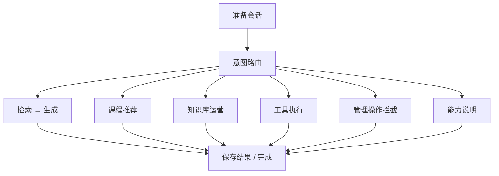

# Agent 工作流

图定义节选见 [graph.py](../code-excerpts/agent/graph.py)。

图为便于阅读的概括；真实边与条件分支以代码为准。

## 工具执行边界

ToolSpec 声明名称、版本、输入输出模型、权限、只读标志、重试次数及软超时参数。ToolContext 传递用户、会话、请求和 trace 标识。

ToolExecutor 检查权限并验证参数，调用 handler 后验证输出，并将结果、耗时和错误信息写入工具调用记录。审计序列化限制文本、列表长度和嵌套深度，按工具配置支持整段隐藏输入输出；它不是通用 PII 检测器。

`timeout_ms` 在该执行器中属于执行后软超时判断，不能中止正在运行的 handler。重试也不能自动保证有副作用操作的幂等性。完整工程的写操作确认另由权限与工作流模块处理，公开执行器本身没有覆盖全部确认逻辑。

## 可观察性

图节点计时、工具调用记录、审计日志以及 LangSmith 接入为不同层次的排查提供入口。公开仓库不包含真实用户的 trace 或调用日志。
